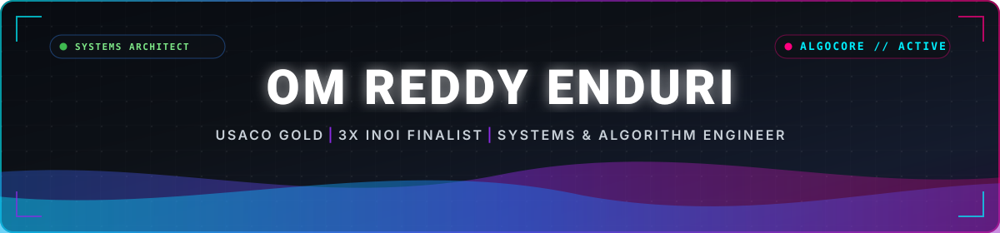

<!--
  OM REDDY ENDURI — Official GitHub Profile README
  GitHub account: OmReddyEnduri
  Repository: OmReddyEnduri/OmReddyEnduri
-->

<div align="center">

<a href="https://github.com/OmReddyEnduri">
  
</a>

<a href="https://readme-typing-svg.demolab.com">
  
</a>

<br/>

<a href="https://github.com/OmReddyEnduri">
  
</a>
<a href="https://github.com/OmReddyEnduri?tab=followers">
  
</a>
<a href="https://github.com/OmReddyEnduri?tab=repositories">
  
</a>


<br/><br/>

<a href="#about-me">About</a> •
<a href="#competitive-programming">Competitive Programming</a> •
<a href="#honors--achievements">Honors</a> •
<a href="#featured-projects">Projects</a> •
<a href="#technology-stack">Tech Stack</a> •
<a href="#github-analytics">Analytics</a> •
<a href="#contribution-snake">Snake</a> •
<a href="#connect">Connect</a>

<br/><br/>

**Bridging the gap between high-level algorithmic logic and low-latency systems engineering.**

</div>

---

## About Me


Hey! I'm **Om Reddy Enduri** — an algorithmic problem solver, C++20 programmer, USACO Gold competitor, and systems engineer.

My focus sits at the intersection of **rigorous algorithmic thinking** and **high-performance systems engineering**. I specialize in competitive programming, designing optimal zero-overhead data structures, and architecting local-first, privacy-respecting developer tools.

### Core Highlights

- 🏆 **Competitive Programming:** USACO Gold Division competitor and 3X INOI (Indian National Olympiad in Informatics) finalist.
- ⚡ **Algorithmic Mastery:** Deep focus on advanced data structures — Lazy/Persistent Segment Trees, Treaps, DSU with rollback, and Heavy-Light Decomposition (HLD).
- 💻 **Systems & C++20:** Authoring zero-overhead template libraries, differential fuzzing engines, and high-throughput tooling.
- 🛡️ **Local-First Architecture:** Building offline-first developer software powered by SQLite WAL, content-addressed storage, and cryptographic privacy shields.
- ⚙️ **Hardware & Microcontrollers:** Hands-on embedded firmware development across ESP32, STM32, and Arduino platforms.

<br clear="right"/>

### The Way I Solve Problems

```text
  understand  ->  formalize invariants
       |                     |
       v                     v
  design algo ->  analyze complexity
       |                     |
       v                     v
  implement   ->  fuzz & delta-minimize
       |                     |
       +--------->  optimize & ship
```

---

## Competitive Programming

<div align="center">


</div>

Competitive programming is the foundation of my engineering discipline. I use national olympiads and international platforms to train algorithmic intuition, asymptotic analysis, and error-free implementation under strict constraints.

### Algorithmic Toolkit

| Domain | Key Data Structures & Algorithmic Patterns | Complexity Target |
|:--|:--|:--:|
| **Trees & Range Queries** | Lazy Segment Trees, Fenwick (BIT), Treaps, Splay Trees, Heavy-Light Decomposition (HLD) | $O(\log N)$ |
| **Disjoint Sets & Graphs** | DSU with Rollback, Tarjan's SCC, 2-SAT, Dijkstra SSSP, Min-Cost Max-Flow | $O(V + E)$ |
| **Strings & Automata** | Knuth-Morris-Pratt (KMP), Z-Algorithm, Aho-Corasick Automaton, Prefix Tries | $O(N + M)$ |
| **Dynamic Programming** | Convex Hull Trick (CHT), Divide & Conquer Optimization, SOS DP, Tree DP, Bitmask DP | $O(N \log N)$ |
| **Number Theory & Math** | Sieve of Eratosthenes, Extended Euclidean, Modular Inverse, Fast Exponentiation, CRT | $O(\log \text{Mod})$ |

### Production Contest Fast I/O Template (C++20)

```cpp
/**
 * @file template.cpp
 * @author Om Reddy Enduri (USACO Gold | 3X INOI Finalist)
 * @brief High-performance competitive programming template with fast I/O
 */
#pragma GCC optimize("O3,unroll-loops")
#include <iostream>
#include <vector>
#include <algorithm>
#include <string>

using int64 = long long;

void solve() {
    // Optimal algorithmic implementation
}

int main() {
    std::ios_base::sync_with_stdio(false);
    std::cin.tie(nullptr);

    int test_cases = 1;
    if constexpr (false) std::cin >> test_cases;
    while (test_cases--) {
        solve();
    }
    return 0;
}
```

---

## Honors & Achievements

<div align="center">


### 🥇 USACO GOLD DIVISION & 3X INOI FINALIST


*Recognized for national-level problem solving, algorithmic velocity, and rigorous correctness under contest pressure.*

</div>

- **USACO Gold Division:** Advanced through Bronze and Silver into the prestigious Gold division of the USA Computing Olympiad.
- **3X INOI Finalist:** Three-time national qualifier for the Indian National Olympiad in Informatics (organized by IARCS).
- **Open Source Architect:** Built and shipped 8 production-grade open source developer tools, contest radar, and CP libraries.

---

## Featured Projects

I architect and maintain open source software solving real developer, algorithmic, and workflow problems with clean design and performance.

<div align="center">

<a href="https://github.com/OmReddyEnduri/StressCraft">
  
</a>
<a href="https://github.com/OmReddyEnduri/AlgoCore-CPP">
  
</a>

<a href="https://github.com/OmReddyEnduri/AlgoRadar">
  
</a>
<a href="https://github.com/OmReddyEnduri/SkillGrid">
  
</a>

<a href="https://github.com/OmReddyEnduri/FileChronicle">
  
</a>
<a href="https://github.com/OmReddyEnduri/RepoSanitizer">
  
</a>

<a href="https://github.com/OmReddyEnduri/ReleasePilot">
  
</a>
<a href="https://github.com/OmReddyEnduri/SnippetVault">
  
</a>

</div>

---

### 01 — StressCraft

**High-performance automated competitive programming differential fuzzing and delta-debugging engine.**

<a href="https://github.com/OmReddyEnduri/StressCraft">
  
</a>


StressCraft automates the discovery and root-cause analysis of failing test cases in competitive programming, replacing fragile ad-hoc scripts with an industrial-grade testing harness.

- **Automated Differential Fuzzing:** Concurrently executes candidate solutions against naive brute-force or model solutions.
- **CP-Specific Template DSL:** Generates arrays, permutations, uniformly random Cayley trees via Prüfer sequences, and connected weighted graphs.
- **Hierarchical Delta-Debugging (`ddmin`):** Automatically shrinks massive failing counterexamples down to the minimal reproducible test case (e.g. $N=100,000 \to N=3$).
- **Asymptotic Complexity Profiler:** Benchmarks runtime and memory scaling across orders of magnitude to catch TLE risks before submission.
- **Interactive Rich CLI:** Colorized failure panels, live execution telemetry, and token-level diff views.

**Technology:** `Python 3` · `Rich` · `Delta-Debugging (ddmin)` · `Prüfer Sequences` · `CLI`

---

### 02 — AlgoCore-CPP

**Modern, verified, header-only competitive programming algorithms & data structures library.**

<a href="https://github.com/OmReddyEnduri/AlgoCore-CPP">
  
</a>


AlgoCore-CPP provides modern, zero-overhead algorithmic building blocks designed for high-speed contest prototyping without external linker dependencies.

- **Modern C++20 Standards:** Built using C++20 concepts for maximum compile-time type safety with zero runtime abstraction penalties.
- **Header-Only Simplicity:** Direct `#include "algocore/..."` integration into any contest submission or project.
- **Core Data Structures:** Generic Point/Range Segment Trees, Binary Indexed Trees (Fenwick), and Disjoint Set Union (DSU) with rank and path compression.
- **Graph & String Engines:** Priority-queue Dijkstra SSSP with path reconstruction, Tarjan's Strongly Connected Components (SCC), KMP, and Trie.
- **Modular Arithmetic:** Fully templated `Modular<Mod>` with fast exponentiation, division, and modular inverse.

**Technology:** `C++20` · `Templates & Concepts` · `CMake` · `Zero-Overhead` · `Data Structures`

---

### 03 — AlgoRadar

**Terminal-based competitive programming contest radar and calendar workstation.**

<a href="https://github.com/OmReddyEnduri/AlgoRadar">
  
</a>


AlgoRadar synchronizes and visualizes competitive programming contests from across the globe into a lightning-fast terminal dashboard.

- **Multi-Platform Concurrent Sync:** Aggregates live feeds from Codeforces, LeetCode, AtCoder, CodeChef, and HackerRank with automatic fallback redundancy.
- **100% Local & Zero Telemetry:** Runs strictly against a local SQLite database in WAL mode with sub-millisecond startup.
- **Live Countdown Timers:** Human-readable status indicators (`in 3h 15m`, `Running`) and automated contest lifecycle transitions.
- **RFC 5545 iCalendar Export:** One-click `.ics` calendar generation for Google Calendar, Apple Calendar, and Outlook with automated 15-minute alarms.
- **Keyboard-First Interface:** Rich ASCII tables, quick filters by platform, and instant terminal briefings.

**Technology:** `Python 3` · `SQLite (WAL)` · `Rich TUI` · `RFC 5545 iCalendar` · `REST/GraphQL APIs`

---

### 04 — SkillGrid

**Local-first direct trade discovery and privacy-shielded hiring engine.**

<a href="https://github.com/OmReddyEnduri/SkillGrid">
  
</a>


SkillGrid streamlines direct, bilateral connections between clients and skilled trade professionals with complete privacy protection.

- **Local-First & Zero Dependencies:** Operates entirely with the Python standard library and SQLite persistence—no cloud lock-in.
- **Privacy-Preserving Contact Shield:** Sensitive contact details remain masked until both parties grant mutual, bilateral consent verified by cryptographic tokens.
- **Dual-Mode Operation:** Instant switching between **Hiring Mode** (client job requests) and **Working Mode** (tradesperson bids).
- **Multi-Factor Discovery Engine:** Search across trade categories with rate constraints, proximity filters, and composite quality scoring.
- **Interactive Web Dashboard & CLI:** Embedded HTTP microservice delivering REST APIs and a responsive single-page web application.

**Technology:** `Python 3` · `SQLite` · `Vanilla JS/SPA` · `HTTP REST` · `HMAC Cryptography`

---

### 05 — FileChronicle

**Universal differential file intelligence, revision snapshot engine, and rollback recovery.**

<a href="https://github.com/OmReddyEnduri/FileChronicle">
  
</a>


FileChronicle is an offline-first differential snapshot engine designed to record, track, and restore file states across development workspaces.

- **Content-Addressable Storage:** SHA-256 chunked streaming deduplication with zlib compression for minimal disk footprint.
- **Differential Snapshot Engine:** Generates line-level unified diffs (+/- additions and removals) across tracked workspace directories.
- **Safe Rollback & Recovery:** Restores any prior revision with automatic backup (`.bak`) preservation to prevent accidental data loss.
- **Multi-Project Workspace Tracking:** Track and monitor multiple independent projects from a single unified CLI tool.
- **Zero External Dependencies:** Built entirely with Python standard library and embedded SQLite WAL storage.

**Technology:** `Python 3` · `SQLite (WAL)` · `SHA-256` · `zlib` · `difflib` · `CLI`

---

### 06 — RepoSanitizer

**Local-first developer repository hygiene auditor and secret/credential leak scanner.**

<a href="https://github.com/OmReddyEnduri/RepoSanitizer">
  
</a>


RepoSanitizer audits repositories locally for exposed credentials, missing essential project files, uncommitted changes, and oversized binary blobs.

- **High-Precision Secret Audits:** Shannon entropy verification detecting AWS keys, GitHub PATs, Stripe tokens, Slack webhooks, and private keys.
- **Actionable Health Scoring:** Evaluates repository health on a 0–100 scale with letter grades (A+ to F) and step-by-step remediation advice.
- **Large Blob Detection:** Flags accidental commits of oversized binary assets (>10MB) before pushing to remote history.
- **CI/CD Ready:** Strict exit codes (`reposanitizer check --threshold 85`) for automated pre-commit hooks and GitHub Actions pipelines.
- **Multi-Format Export:** Generates colorized terminal dashboards, machine-readable JSON, and GitHub-flavored Markdown audit summaries.

**Technology:** `Python 3` · `Shannon Entropy` · `Security Auditing` · `GitHub Actions CI` · `Rich CLI`

---

### 07 — ReleasePilot

**Developer workspace for Semantic Versioning (SemVer 2.0.0) and automated release packaging.**

<a href="https://github.com/OmReddyEnduri/ReleasePilot">
  
</a>


ReleasePilot coordinates release readiness, Keep a Changelog validation, and multi-file version bumps into a single command.

- **Release Hygiene Validation:** Verifies full SemVer 2.0.0 conformity, changelog formatting, release date integrity, and manifest synchronization.
- **Atomic Multi-Target Bumper:** Increments `patch`, `minor`, or `major` across `pyproject.toml`, `package.json`, `releasepilot.json`, and `CHANGELOG.md` in one atomic operation.
- **Deterministic Packaging:** Builds compressed release bundles (`.zip` and `.tar.gz`) with accompanying streaming `SHA256SUMS` checksums.
- **Automatic Release Notes:** Extracts structured release notes for specific tags or unreleased changes ready for GitHub Releases.
- **Zero External Dependencies:** 100% standard-library Python utility engineered for frictionless local and CI workflows.

**Technology:** `Python 3` · `SemVer 2.0.0` · `Packaging Engine` · `SHA-256` · `CLI`

---

### 08 — SnippetVault

**Local developer code snippet catalog, full-text search engine, and terminal vault.**

<a href="https://github.com/OmReddyEnduri/SnippetVault">
  
</a>


SnippetVault is a lightning-fast developer shelf for your terminal, storing and searching your code snippets entirely on your local machine.

- **Instant Local SQLite Storage:** Zero server dependencies, single-file database (`~/.snippetvault/vault.db`) with complete offline privacy.
- **Full-Text Search Engine:** Real-time sub-millisecond search across titles, code content, tags, and descriptions using SQLite FTS5 index.
- **Terminal Syntax Highlighting:** Beautiful Monokai syntax highlighting and metadata cards powered by `rich`.
- **Seamless Clipboard Sync:** One-key copy (`vault copy <id>`) with fallback to OS native utilities (`clip.exe`, `pbcopy`, `xclip`).
- **Markdown Catalog Exporter:** Export your snippet library to a linked Markdown document with Table of Contents and syntax fences.

**Technology:** `Python 3` · `SQLite FTS5` · `Rich` · `OS Clipboard API` · `CLI`

---

<div align="center">

<a href="https://github.com/OmReddyEnduri?tab=repositories">
  
</a>

</div>

---

## Technology Stack

### Hardware & Embedded Systems
<div align="center">
  
</div>

<br/>

### Programming Languages
<div align="center">
  
</div>

<br/>

### Web, APIs & Databases
<div align="center">
  
</div>

<br/>

### Tools & DevOps Infrastructure
<div align="center">
  
</div>

<br/>

### Technical Proficiency Matrix

| Domain | Technologies & Frameworks |
|:--|:--|
| **Core Languages** | Modern C++ (C++20), Python 3, Rust, Go, TypeScript, JavaScript, C |
| **Embedded & Systems** | ESP32, ESP8266, STM32, Arduino Mega 2560, Embedded C, FreeRTOS, Circuit Prototyping |
| **Web & Services** | FastAPI, Node.js, React, RESTful API Architecture, Single Page Applications |
| **Databases & Storage** | SQLite (WAL mode, FTS5), PostgreSQL, Redis, Content-Addressable Storage Engines |
| **DevOps & Tooling** | Linux (Arch / Debian), CMake, Git, GitHub Actions CI/CD, Docker, VS Code |
| **Algorithmic Specialization** | Advanced Data Structures, Graph Theory, Number Theory, Differential Fuzzing |

---

## GitHub Analytics

<div align="center">


<br/><br/>


<br/><br/>


<br/><br/>


</div>

---

## Contribution Snake

<p align="center">
  <picture>
    <source media="(prefers-color-scheme: dark)"
      srcset="https://raw.githubusercontent.com/OmReddyEnduri/OmReddyEnduri/output/github-contribution-grid-snake-dark.svg">
    <source media="(prefers-color-scheme: light)"
      srcset="https://raw.githubusercontent.com/OmReddyEnduri/OmReddyEnduri/output/github-contribution-grid-snake.svg">
    
  </picture>
</p>

---

## Currently Learning

```text
╭─────────────────────────────────────────────────────────────────────────────╮
│  OM'S CURRENT LEARNING & ADVANCEMENT LOG                                    │
├─────────────────────────────────────────────────────────────────────────────┤
│  [x] Advanced Competitive Programming (USACO Gold / INOI Finalist)          │
│  [x] Modern C++20 standard, concepts, and template metaprogramming          │
│  [x] Local-first storage architectures and differential SQLite syncing      │
│  [>] Link-Cut Trees, Splay Trees, and Wavelet Matrix implementations       │
│  [>] Cache-oblivious algorithms and hardware prefetching optimizations      │
│  [>] Distributed consensus, Raft implementations, and WAL protocols         │
│  [>] High-throughput asynchronous systems engineering                       │
╰─────────────────────────────────────────────────────────────────────────────╯
```

---

## Connect

<div align="center">

<a href="https://github.com/OmReddyEnduri">
  
</a>
<a href="https://codeforces.com/profile/OmReddyEnduri">
  
</a>
<a href="https://linkedin.com">
  
</a>
<a href="mailto:omtheprogrammer1@gmail.com">
  
</a>

<br/><br/>

**Open to discussing advanced algorithms, modern C++, systems engineering, and open source collaboration.**

</div>

---

<div align="center">


### `while (curious) { learn(); build(); solve(); repeat(); }`

<sub>Crafted with passion, algorithmic rigor & curiosity — thanks for stopping by!</sub>

<br/><br/>


</div>
